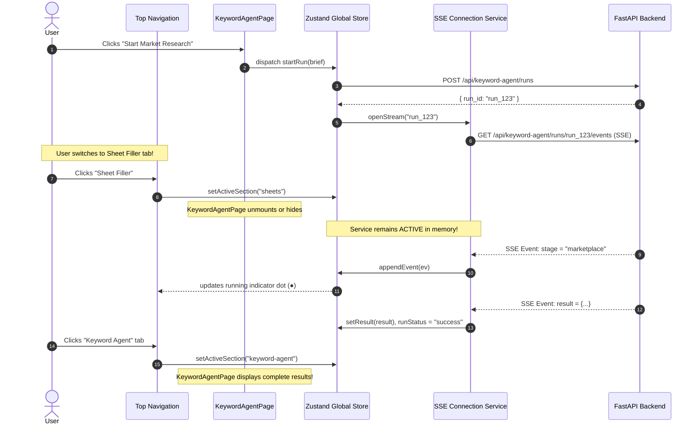

# SheetFill State Persistence Architecture Specification

**Project**: SheetFill (`cfradar/sheetfill`)  
**Document**: Multi-Tab State Persistence, IndexedDB Storage & Job Lifecycle  
**Author**: Antigravity Technical Architecture Agent  
**Date**: October 18, 2026  
**Status**: Ready for User Review & Approval  

---

## 1. Problem Statement & Architecture Goals

### The Problem
In the current implementation:
1. When a user switches between the **Sheet Filler** and **Keyword Agent** tabs via the top navbar, the previous view unmounts completely from the React DOM tree.
2. In `KeywordAgentPage.tsx`, the `brief`, `currentRunId`, `isRunning`, `events`, and `result` are stored entirely in local `useState` hooks.
3. When the component unmounts, the `useEffect` cleanup hook triggers `cleanupSSE.current()`, aborting the active SSE streaming connection and discarding all research results.
4. When the user returns to the tab, the form resets to `DEFAULT_BRIEF` and all competitor scraping data is lost.
5. In `Sheet Filler`, while `useAppStore` holds `session`, refreshing the browser or clearing URL parameters loses the active selection, active design index, filter tab, and uncommitted JSON drafts.

### Architecture Goals
1. **Zero Data Loss on Tab Switch**: Switching between tabs must never clear or reset in-progress work.
2. **Persistent AI Pipeline**: A running Keyword Agent job (SSE stream) must live in a persistent service singleton in the store, independent of component mount/unmount cycles.
3. **Survive Page Reloads**: State persists to **IndexedDB** using an asynchronous storage adapter.
4. **Zero Heavy Blobs Stored**: Raw 25MB Excel files are never stored in browser memory; only `session_id`, design metadata, and JSON strings are stored.
5. **Zero API Key Leaks**: BYOK OpenRouter keys are never stored in client local storage or IndexedDB; they remain server-side encrypted in MongoDB.
6. **Explicit Reset Actions**: Data never clears automatically. Each tab has a visible but unobtrusive "Reset" action, plus a global "Reset All Workspaces" in the avatar menu.
7. **Schema Versioning & Migration**: Safe upgrade path for future state schema changes.

---

## 2. Store Shape & Slice Separation

The global state is unified under a single Zustand store with two distinct slices and an active navigation slice:

```ts
interface GlobalStoreState {
  version: number;
  activeSection: "sheets" | "keyword-agent" | "admin";
  setActiveSection: (section: "sheets" | "keyword-agent" | "admin") => void;

  // -------------------------------------------------------------
  // SLICE 1: Sheet Filler Workspace
  // -------------------------------------------------------------
  sheetFiller: {
    sessionId: string | null;
    filename: string | null;
    outputFilename: string | null;
    downloadUrl: string | null;
    activeDesignId: string | null;
    filterMode: "all" | "needs_info" | "ready";
    expandedDesigns: Record<string, boolean>;
    catalogDefaults: {
      brand: string;
      packer: string;
      manufacturer: string;
      countryOfOrigin: string;
      mrp: number;
      price: number;
      hsn: string;
    };
    designSizes: Record<string, string[]>;
    designRawText: Record<string, string>;
    designJsons: Record<string, any>;
    designs: Array<{
      id: string;
      title: string;
      sku: string;
      status: "pending" | "ready" | "complete" | "error";
      sizesFound: string[];
    }>;
    summary: {
      totalDesigns: number;
      readyDesigns: number;
      roomForNewDesigns: number;
    } | null;
    report: any | null;
    isBulkDialogOpen: boolean;
  };

  // Sheet Filler Actions
  setSheetSession: (session: any) => void;
  setActiveDesignId: (id: string) => void;
  setFilterMode: (mode: "all" | "needs_info" | "ready") => void;
  updateCatalogDefaults: (defaults: Partial<GlobalStoreState["sheetFiller"]["catalogDefaults"]>) => void;
  updateDesignJsonText: (designId: string, text: string) => void;
  updateDesignSizes: (designId: string, sizes: string[]) => void;
  resetSheetFiller: () => void;

  // -------------------------------------------------------------
  // SLICE 2: Marketplace Keyword Agent
  // -------------------------------------------------------------
  keywordAgent: {
    brief: ProductBrief;
    currentRunId: string | null;
    runStatus: "idle" | "running" | "success" | "error" | "cancelled";
    currentStage: "planner" | "marketplace" | "social" | "analyst" | "system" | null;
    events: SSEEvent[];
    result: RunResult | null;
    errorMsg: string | null;
    chatMessages: Array<{ role: "user" | "assistant"; content: string; ts: number }>;
  };

  // Keyword Agent Actions
  updateBrief: (brief: Partial<ProductBrief>) => void;
  startRun: (brief: ProductBrief) => Promise<void>;
  cancelCurrentRun: () => Promise<void>;
  submitChatRefine: (message: string) => Promise<void>;
  resetKeywordAgent: () => void;

  // -------------------------------------------------------------
  // GLOBAL RESET
  // -------------------------------------------------------------
  resetAllWorkspaces: () => void;
}
```

---

## 3. Persistent SSE Pipeline Architecture

To allow AI market research runs to continue smoothly while the user edits sheets in the Sheet Filler:



### Connection Management Rules
1. The `AbortController` and `getReader()` loop are held in a module-level singleton `sseService` inside `frontend/src/features/keyword-agent/service/sseManager.ts`.
2. When the user navigates away, the `sseManager` continues receiving chunks, parsing events, updating the store, and persisting to IndexedDB.
3. If the user explicitly clicks "Cancel Run", `sseManager.abort()` is called and backend cancel endpoint is invoked.
4. On browser reload while a run is marked `"running"`, the store reconnects to `/api/keyword-agent/runs/{run_id}/events` or checks `/api/keyword-agent/runs/{run_id}` to retrieve completed output.

---

## 4. IndexedDB Storage Engine Specification

### Why IndexedDB Over localStorage?
- `localStorage` has a strict 5MB synchronous limit and blocks the main UI thread during serialization.
- IndexedDB provides asynchronous, non-blocking storage with virtually unlimited quota (hundreds of megabytes), ideal for multi-product JSON specifications and comprehensive competitor analytics.

### Implementation: Zero-Dependency IndexedDB Adapter (`idbStorage.ts`)

```ts
import { StateStorage } from "zustand/middleware";

const DB_NAME = "SheetFillAppDB";
const STORE_NAME = "app_state_store";
const DB_VERSION = 1;

function getDB(): Promise<IDBDatabase> {
  return new Promise((resolve, reject) => {
    const request = indexedDB.open(DB_NAME, DB_VERSION);
    request.onupgradeneeded = () => {
      const db = request.result;
      if (!db.objectStoreNames.contains(STORE_NAME)) {
        db.createObjectStore(STORE_NAME);
      }
    };
    request.onsuccess = () => resolve(request.result);
    request.onerror = () => reject(request.error);
  });
}

export const idbStorage: StateStorage = {
  getItem: async (name: string): Promise<string | null> => {
    const db = await getDB();
    return new Promise((resolve, reject) => {
      const tx = db.transaction(STORE_NAME, "readonly");
      const store = tx.objectStore(STORE_NAME);
      const req = store.get(name);
      req.onsuccess = () => resolve(req.result || null);
      req.onerror = () => reject(req.error);
    });
  },
  setItem: async (name: string, value: string): Promise<void> => {
    const db = await getDB();
    return new Promise((resolve, reject) => {
      const tx = db.transaction(STORE_NAME, "readwrite");
      const store = tx.objectStore(STORE_NAME);
      const req = store.put(value, name);
      req.onsuccess = () => resolve();
      req.onerror = () => reject(req.error);
    });
  },
  removeItem: async (name: string): Promise<void> => {
    const db = await getDB();
    return new Promise((resolve, reject) => {
      const tx = db.transaction(STORE_NAME, "readwrite");
      const store = tx.objectStore(STORE_NAME);
      const req = store.delete(name);
      req.onsuccess = () => resolve();
      req.onerror = () => reject(req.error);
    });
  },
};
```

---

## 5. Schema Versioning & Migration Plan

The store declares a `version: 1` property in `persist`:

```ts
persist(
  (set, get) => ({ ... }),
  {
    name: "sheetfill_workspace_v1",
    storage: createJSONStorage(() => idbStorage),
    version: 1,
    migrate: (persistedState: any, version: number) => {
      if (version === 0) {
        // Migration from legacy unversioned store
        return {
          ...defaultInitialState,
          sheetFiller: {
            ...defaultInitialState.sheetFiller,
            sessionId: persistedState.session?.session_id || null,
          },
        };
      }
      return persistedState as GlobalStoreState;
    },
    partialize: (state) => ({
      // Blacklist non-persistent temporary items
      sheetFiller: state.sheetFiller,
      keywordAgent: {
        brief: state.keywordAgent.brief,
        currentRunId: state.keywordAgent.currentRunId,
        runStatus: state.keywordAgent.runStatus,
        result: state.keywordAgent.result,
        chatMessages: state.keywordAgent.chatMessages,
      },
    }),
  }
)
```

---

## 6. Reset Behaviors & Confirmation Dialogs

1. **Sheet Filler Tab Reset ("New Sheet")**:
   - Location: Secondary action in the top Sticky Toolbar.
   - Behavior: Prompts user: *"Start a new sheet? Your active designs will be cleared from this workspace."*
   - Clears: ONLY `state.sheetFiller`. The `state.keywordAgent` remains completely untouched!
   - Toast: *"Sheet workspace reset."*

2. **Keyword Agent Tab Reset ("New Research")**:
   - Location: Top right of Keyword Agent brief/results panel.
   - Behavior: Prompts user: *"Start fresh research? Current generated titles and keywords will be cleared."*
   - Clears: ONLY `state.keywordAgent` (resets form to default template). The `state.sheetFiller` remains completely untouched!
   - Toast: *"Keyword agent reset."*

3. **Global Workspace Reset ("Reset All")**:
   - Location: Top navigation user avatar dropdown menu.
   - Behavior: Modal confirmation with warning: *"Clear all local workspaces? This resets both your Excel sheet designs and keyword research results."*
   - Clears: Both `sheetFiller` and `keywordAgent` slices, and wipes the IndexedDB storage key.
   - Toast: *"All workspaces reset to defaults."*

---

## 7. Automated Test Plan for State Persistence

We will create automated Vitest integration tests in `frontend/src/store/storePersistence.test.ts`:

1. **Test 1: Tab Switch Retention**:
   - Set active sheet session with 4 designs and JSON.
   - Switch `activeSection` from `"sheets"` to `"keyword-agent"`.
   - Update `keywordAgent.brief.color` to `"Olive"`.
   - Switch back to `"sheets"`.
   - **Assert**: Sheet designs, session ID, and JSON remain 100% intact.
   - Switch back to `"keyword-agent"`.
   - **Assert**: `keywordAgent.brief.color` is still `"Olive"`.

2. **Test 2: Page Refresh Simulation (IndexedDB Rehydration)**:
   - Populate store and trigger serialization to IndexedDB.
   - Instantiate a fresh store instance reading from the same storage adapter.
   - **Assert**: All designs, active index, and keyword results are restored identically.

3. **Test 3: Slice Isolation on Reset**:
   - Call `resetSheetFiller()`.
   - **Assert**: `sheetFiller` is null/empty.
   - **Assert**: `keywordAgent` results and brief are 100% preserved.

4. **Test 4: Background Stream Persistence**:
   - Start simulated SSE stream in store.
   - Toggle navigation sections 5 times.
   - Emit SSE `result` event.
   - **Assert**: Store receives and stores the final result without errors.
