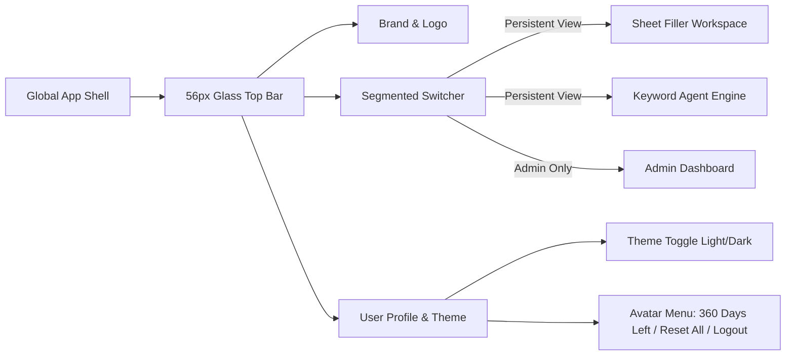
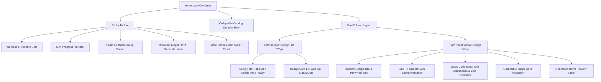

# SheetFill UI Wireframes & Layout Specification

**Project**: SheetFill (`cfradar/sheetfill`)  
**Document**: Screen Wireframes (ASCII & Mermaid Diagrams)  
**Author**: Antigravity Technical Architecture Agent  
**Date**: October 18, 2026  
**Status**: Ready for User Review & Approval  

---

## 1. Top Navigation Bar Wireframe (56px Glassmorphic)

```
+---------------------------------------------------------------------------------------------------------+
| [Logo] SheetFill        [ (●) Sheet Filler  |  ( ) Keyword Agent  |  ( ) Admin ]       [Sun/Moon]  [Avatar] |
+---------------------------------------------------------------------------------------------------------+
                                 ^ Sliding Spring Indicator Pill                             ^ Subscription 
                                 (Pulsating dot when running)                                  & Reset inside
```

### Mermaid Architecture: Navigation & Section Switching


---

## 2. Screen 1: Hero Upload Dropzone

```
+---------------------------------------------------------------------------------------------------------+
|                                                                                                         |
|                                   [ Ambient Soft Aurora Gradient ]                                      |
|                                                                                                         |
|                     +-------------------------------------------------------------+                     |
|                     |                                                             |                     |
|                     |                    [ UploadCloud Icon ]                     |                     |
|                     |                                                             |                     |
|                     |                Upload Flipkart Listing Sheet                |                     |
|                     |    Drop your .xlsm or .xls workbook to auto-fill designs    |                     |
|                     |                                                             |                     |
|                     |   +-----------------------------------------------------+   |                     |
|                     |   |                                                     |   |                     |
|                     |   |            [ Antigravity Kinetic Canvas ]           |   |                     |
|                     |   |                                                     |   |                     |
|                     |   |             [ FileSpreadsheet Hero Icon ]           |   |                     |
|                     |   |                                                     |   |                     |
|                     |   |          Choose workbook or drag & drop here        |   |                     |
|                     |   |                                                     |   |                     |
|                     |   +-----------------------------------------------------+   |                     |
|                     |                                                             |                     |
|                     |       Supports .xlsm & .xls · Macro-safe · Max 25 MB        |                     |
|                     |                                                             |                     |
|                     +-------------------------------------------------------------+                     |
|                                                                                                         |
+---------------------------------------------------------------------------------------------------------+
```

---

## 3. Screen 2: Sheet Filler Workspace

```
+---------------------------------------------------------------------------------------------------------+
| [File: Flipkart_TShirts.xlsm]  (======= 14 of 16 ready =======)             [Paste All JSON] [Generate .xlsm v] |
+---------------------------------------------------------------------------------------------------------+
| > Catalog Defaults: Brand "UrbanStyle" · Packer "StyleCorp" · MRP ₹1,999 · ₹749 · HSN 61091000  [Edit v] |
+-----------------------------------+---------------------------------------------------------------------+
| DESIGNS (16)                      | DESIGN 3 OF 16: Oversized Anime Print                     [Next >]  |
| [All (16)] [Needs (2)] [Ready(14)]|                                                                     |
|-----------------------------------| +-- SIZES --------------------------------------------------------+ |
| [Thumb] #01 Typography Tee    (●) | |  [ S ]  [ M ]  [ L ]  [ XL ]  [ XXL ]    4 rows will be generated   | |
|         SKU: TEE-001   Ready      | +-----------------------------------------------------------------+ |
|-----------------------------------|                                                                     |
| [Thumb] #02 Striped Polo      (●) | +-- PRODUCT SPECIFICATION JSON -----------------------------------+ |
|         SKU: POLO-002  Ready      | | [1] {                                     [Copy] [Format/Repair]| |
|-----------------------------------| | [2]   "product_title": "Men Oversized Anime Graphic T-Shirt",   | |
| [Thumb] #03 Anime Oversized   (○) | | [3]   "brand": "UrbanStyle",                                    | |
|         SKU: TEE-003   Pending    | | [4]   "color": "Black",                                         | |
|-----------------------------------| | [5]   "fabric": "100% Cotton",                                  | |
| [Thumb] #04 Minimalist Tee    (●) | | [6]   "neck": "Round Neck"                                      | |
|         SKU: TEE-004   Ready      | | [7] }                                                           | |
|                                   | +-----------------------------------------------------------------+ |
|                                   |                                                                     |
|                                   | +-- IMAGE LINKS (OPTIONAL) ---------------------------------[+]--+ |
|                                   | | [Front URL] [Back URL] [Side URL]                               | |
|                                   | +-----------------------------------------------------------------+ |
+-----------------------------------+---------------------------------------------------------------------+
```

### Mermaid Architecture: Sheet Workspace Component Hierarchy


---

## 4. Screen 3: Keyword Agent Brief Form

```
+---------------------------------------------------------------------------------------------------------+
|                                    MARKETPLACE KEYWORD AGENT                                            |
|                  Generate high-ranking listing titles and search-optimized keywords                     |
+---------------------------------------------------------------------------------------------------------+
|                                                                                                         |
|  1. TARGET MARKETPLACES                                                                                 |
|  [✓ Amazon]    [✓ Flipkart]    [✓ Myntra]    [✓ Meesho]                                                 |
|                                                                                                         |
|  2. PRODUCT BASICS                                                                                      |
|  T-Shirt Type:   (●) Oversized    ( ) Regular Fit    ( ) Polo    ( ) Sleeveless    ( ) Hooded           |
|  Gender:         (●) Men          ( ) Women          ( ) Unisex  ( ) Kids                               |
|  Color:          [■ Black]  [□ White]  [■ Navy]  [■ Olive]  [■ Maroon]  [+ Custom]                      |
|                                                                                                         |
|  3. FABRIC & ATTRIBUTES                                                                                 |
|  Fabric: [ 100% Cotton                   ]   Neck Type:    [ Round Neck               ]                 |
|  Sleeve: [ Half Sleeve                   ]   Pattern:      [ Graphic Print            ]                 |
|                                                                                                         |
|  4. PRICING & MARKET CONTEXT                                                                            |
|  Price Range: [ ₹599 ] to [ ₹999 ]           Brand Name:   [ UrbanStyle               ]                 |
|  Special Features / Aesthetic:                                                                          |
|  [ Heavyweight 240 GSM drop shoulder streetwear tee with Japanese anime back graphic print            ] |
|                                                                                                         |
|  5. DEEP SEARCH SOURCES                                                                                 |
|  [✓ Amazon Search]  [✓ Flipkart Catalog]  [✓ Myntra Trends]  [✓ Meesho]  [✓ Google Trends] [✓ Reddit]   |
|                                                                                                         |
|  -----------------------------------------------------------------------------------------------------  |
|  [⚙ Multi-Key BYOK Settings]                                              [ Start Market Research -> ]  |
|                                                                                                         |
+---------------------------------------------------------------------------------------------------------+
```

---

## 5. Screen 4: Keyword Agent In-Progress Pipeline View

```
+---------------------------------------------------------------------------------------------------------+
|                                    MARKETPLACE KEYWORD AGENT                                            |
+---------------------------------------------------------------------------------------------------------+
|                                                                                                         |
|  PIPELINE EXECUTION IN PROGRESS: Run #run_9a2f1b                                                        |
|                                                                                                         |
|   (✓) Planner -----[======]-----> (●) Scraper ------------> ( ) Social ------------> ( ) AI Analyst     |
|   Target Matrix Ready             Scraping Flipkart & Amazon       Pending                   Pending    |
|                                                                                                         |
|  +-- LIVE PIPELINE ACTIVITY TERMINAL -------------------------------------------------[ Collapse ]---+ |
|  | [17:42:01] Planner: Formulated 18 target search queries across 4 marketplaces.                      | |
|  | [17:42:03] Marketplace Scraper: Fetching live Flipkart catalog for 'oversized anime t shirt'...    | |
|  | [17:42:04] Marketplace Scraper: Extracted 24 competitor items. Computing Bayesian weighted scores.. | |
|  | [17:42:06] Cache: Canonical query hit for 'black oversized cotton t-shirt'.                         | |
|  +----------------------------------------------------------------------------------------------------+ |
|                                                                                                         |
|  +-- SKELETON PREVIEW: RESULTS RENDERING IN BACKGROUND -----------------------------------------------+ |
|  | [░░░░░░░░░░░░░░░░░░░░░]  [░░░░░░░░░░░░░░░░░░░░░]  [░░░░░░░░░░░░░░░░░░░░░]  [░░░░░░░░░░░░░░░░░░░░]   | |
|  | [░░░░░░░░░░░░░░░░░░░░░░░░░░░░░░░░░░░░░░░░░░░░░░░░░░░░░░░░░░░░░░░░░░░░░░░░░░░░░░░░░░░░░░░░░░░░░░░░░]  | |
|  +----------------------------------------------------------------------------------------------------+ |
|                                                                                                         |
|  [ Cancel Run ]                                            (●) Live Stream Active · Auto-persisted      |
|                                                                                                         |
+---------------------------------------------------------------------------------------------------------+
```

---

## 6. Screen 5: Keyword Agent Results Bento Dashboard (Single-Viewport 100vh)

```
+---------------------------------------------------------------------------------------------------------+
| Strategy Ready: Heavyweight Streetwear Oversized T-Shirt (UrbanStyle)             [ Export CSV v ]      |
+-------------------------------------------+-------------------------------------------------------------+
| MARKETPLACE BENCHMARKS & DRILL-DOWN (5/12)| PLATFORM SPECIFICATIONS & TITLES: FLIPKART (7/12)           |
|                                           |                                                             |
| +-- MARKETPLACE SHARE TREEMAP -----------+| +-- OPTIMIZED COMPOSED TITLES ----------------------------+ |
| | [Amazon 32%]      | [Flipkart 28%]     || | Style 1: Search-Optimized (74 chars)           [Copy]   | |
| | 18 keywords       | 16 keywords        || | UrbanStyle Men Oversized Anime Graphic Print Cotton Tee | |
| |-------------------|--------------------|| |                                                          | |
| | [Myntra 22%]      | [Meesho 18%]       || | Style 2: Balanced Marketplace (62 chars)        [Copy]   | |
| | 12 keywords       | 10 keywords        || | UrbanStyle Black Oversized Round Neck T-Shirt - Men     | |
| +----------------------------------------+| +---------------------------------------------------------+ |
|                                           |                                                             |
| +-- RATING DISTRIBUTION (FLIPKART) ------+| +-- SCORED SEARCH KEYWORDS (16) --------------------------+ |
| | Market Avg: 4.2 ★   Bayesian: 4.14     || | High Volume (90+):                                      | |
| | [5★ 48%][4★ 32%][3★ 12%][2★ 5%][1★ 3%] || | [oversized t shirt men +] [anime t shirt +]              | |
| +----------------------------------------+| | [graphic print tee +]    [black oversized tee +]        | |
|                                           | | Medium Volume (70-89):                                  | |
| +-- TOP SCRAPED COMPETITORS -------------+| | [drop shoulder t shirt +] [streetwear cotton tee +]     | |
| | #1 Beyoung Anime Oversized (4.3★)   [>]|| +---------------------------------------------------------+ |
| | #2 Souled Store Graphic Cotton(4.4★)[>]||                                                             |
| | #3 Roadies Drop Shoulder (4.1★)     [>]|| +-- ATTRIBUTES TO FILL IN LISTING SHEET ------------------+ |
| | #4 Bewakoof Streetwear Tee (4.0★)   [>]|| | > Mandatory Fields: Sleeve, Neck, Pattern, Fit Type     | |
| +----------------------------------------+| | > Recommended Tags: #Streetwear #AnimeDropShoulder      | |
|                                           | +---------------------------------------------------------+ |
| +-- REFINE VIA AI CHAT ------------------+|                                                             |
| | [Ask AI to tweak titles or tone...   ] ||                                                             |
| +----------------------------------------+|                                                             |
+-------------------------------------------+-------------------------------------------------------------+
```

---

## 7. Screen 6: Competitor Deep-Dive Slide-in Drawer

```
+-------------------------------------------------------------+
| FLIPKART #1 · COMPETITOR DEEP-DIVE                          |
+-------------------------------------------------------------+
|                                                             |
| Scraped Title:                                              |
| "Beyoung Men Black Anime Back Printed 240 GSM Oversized Tee"|
| Length: 57 characters                                       |
|                                                             |
| Rating & Social Proof:                                      |
| [ ★ 4.3 / 5.0 ]             [ 12,480 Ratings ]              |
|                                                             |
| Brand: Beyoung              Price: ₹649 (MRP ₹1,499)        |
|                                                             |
| Bayesian Weighted Score: 4.22                               |
| Calculated with prior m=10, global average C=4.0.           |
| High confidence verified volume.                            |
|                                                             |
| Key Extracted Keywords:                                     |
| [anime back print] [240 gsm] [oversized tee] [cotton black] |
|                                                             |
| ----------------------------------------------------------- |
| [ Search Live on Flipkart -> ]                      [ Close]|
+-------------------------------------------------------------+
```
